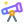
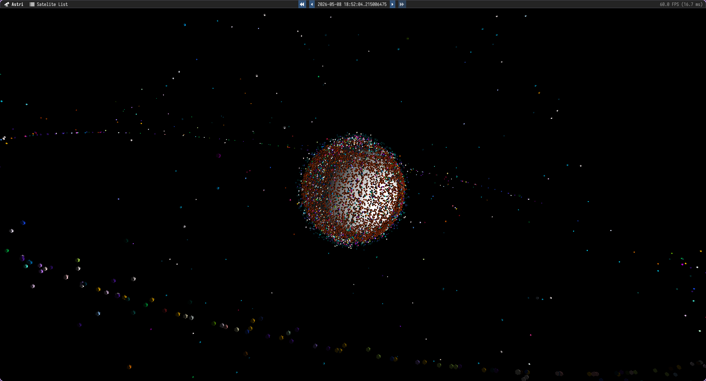

<a id="readme-top"></a>

<br />
<div align="center">
  <a href="https://github.com/Nedra1998/Astri">
    
  </a>

<h3 align="center">Astri</h3>

  <p align="center">
    Real-time satellite tracking and visualization, written in C++.
    <br />
    <br />
    <a href="https://github.com/Nedra1998/Astri/issues/new?labels=bug">Report Bug</a>
  </p>
</div>

<details>
  <summary>Table of Contents</summary>
  <ol>
    <li><a href="#about-the-project">About The Project</a></li>
    <li><a href="#how-it-works">How It Works</a></li>
    <li><a href="#built-with">Built With</a></li>
    <li><a href="#getting-started">Getting Started</a></li>
    <li><a href="#usage">Usage</a></li>
    <li><a href="#roadmap">Roadmap</a></li>
  </ol>
</details>

## About The Project



Astri pulls every publicly tracked satellite from [CelesTrak](https://celestrak.org/) (around 15,000 at the moment) and shows where they are around the Earth in real time. You can speed time up, run it backwards, or pause it and look around.

Satellites are grouped into their constellations automatically. Each group gets its own colour in the 3D view and its own collapsible section in the explorer list, so things like Starlink and OneWeb are easy to spot.

Features:

* Positions predicted with SGP4, the orbital model used by the US Department of Defense
* Thousands of satellites drawn at full frame rate (tested with ~50k)
* Explorer list you can search, sort by name, ID, inclination or altitude, and toggle per satellite or per group
* Time controls for pausing, reversing and changing simulation speed
* Orbit camera with zoom, plus adjustable satellite size so small objects stay visible

<p align="right">(<a href="#readme-top">back to top</a>)</p>

## How It Works

**SGP4 rewrite.** The reference SGP4 implementation is old C code that depends on Windows-only headers. I re-implemented it in modern C++ as a standalone library. Functions that took 80+ loose parameters now take proper data structures, and cryptic names like `argpp` became readable ones like `arg_of_periapsis`. It handles TLE parsing and propagation, and has no dependencies beyond the standard library and a logger.

**Entity Component System.** Every satellite is an entity in [flecs](https://www.flecs.dev/flecs/), holding its orbital element set and render state. Each frame, a single ECS query propagates every visible satellite to the current simulation time.

**Instanced rendering.** All satellites share one mesh and are drawn with a single `glDrawElementsInstanced` call. Per-satellite transforms and colours live in instance buffers, so the GPU cost barely changes whether there are 100 satellites or 50,000.

**Caching.** CelesTrak responses are stored on disk as CBOR with a 24 hour expiry. After the first launch, Astri starts up without touching the network and stays friendly to CelesTrak's rate limits.

**Build setup.** Dependencies are pulled in with [CPM](https://github.com/cpm-cmake/CPM.cmake), so there is nothing to install by hand. Shaders and fonts are compressed and embedded into the binary at build time, so the result is a single self-contained executable. [Tracy](https://github.com/wolfpld/tracy) profiling can be switched on with one CMake flag.

<p align="right">(<a href="#readme-top">back to top</a>)</p>

## Built With

[![C++20][Cpp-badge]][Cpp-url]
[![OpenGL][OpenGL-badge]][OpenGL-url]
[![CMake][CMake-badge]][CMake-url]

* [Dear ImGui](https://github.com/ocornut/imgui) (docking branch) for the UI
* [flecs](https://github.com/SanderMertens/flecs) for the entity component system
* [GLFW](https://www.glfw.org/), [glad](https://github.com/Dav1dde/glad) and [GLM](https://github.com/g-truc/glm) for windowing and graphics
* [cpp-httplib](https://github.com/yhirose/cpp-httplib) and [nlohmann/json](https://github.com/nlohmann/json) for fetching and caching data
* [spdlog](https://github.com/gabime/spdlog) and [Tracy](https://github.com/wolfpld/tracy) for logging and profiling

<p align="right">(<a href="#readme-top">back to top</a>)</p>

## Getting Started

### Prerequisites

* CMake 3.22 or newer
* A C++20 compiler (GCC, Clang or MSVC)
* An OpenGL 3.3 capable GPU
* On Linux, the usual GLFW build packages (X11 or Wayland development headers)

### Building

```sh
git clone https://github.com/Nedra1998/Astri.git
cd Astri
cmake -B build -DCMAKE_BUILD_TYPE=Release
cmake --build build -j
```

To build with Tracy profiling, add `-DASTRI_ENABLE_PROFILING=ON` to the first CMake command.

### Running

```sh
./build/src/astri
```

The first launch needs an internet connection to download satellite data. It is cached in `_cache/` next to where you run it from.

<p align="right">(<a href="#readme-top">back to top</a>)</p>

## Usage

| Key       | Action                              |
| --------- | ----------------------------------- |
| `W` `S`   | Orbit camera up / down              |
| `A` `D`   | Orbit camera left / right           |
| `Q` `E`   | Zoom in / out                       |
| `F` `G`   | Slow down / speed up time           |
| `R` `T`   | Make satellites bigger / smaller    |

Pause, rewind and playback speed presets are also in the menu bar. The explorer window can be docked anywhere and lets you search by name or NORAD ID, sort the columns, and hide whole constellations with one checkbox.

<p align="right">(<a href="#readme-top">back to top</a>)</p>

## Roadmap

- [x] SGP4 propagation for all active satellites
- [x] Constellation grouping and colouring
- [x] Explorer list with search and sorting
- [x] Time controls
- [ ] Textured Earth with day and night lighting
- [ ] Orbit path trails for selected satellites
- [ ] Click to select a satellite in the 3D view
- [ ] WebAssembly build for running in the browser

<p align="right">(<a href="#readme-top">back to top</a>)</p>

[Cpp-badge]: https://img.shields.io/badge/C++20-00599C?style=for-the-badge&logo=cplusplus&logoColor=white
[Cpp-url]: https://isocpp.org/
[OpenGL-badge]: https://img.shields.io/badge/OpenGL-5586A4?style=for-the-badge&logo=opengl&logoColor=white
[OpenGL-url]: https://www.opengl.org/
[CMake-badge]: https://img.shields.io/badge/CMake-064F8C?style=for-the-badge&logo=cmake&logoColor=white
[CMake-url]: https://cmake.org/
